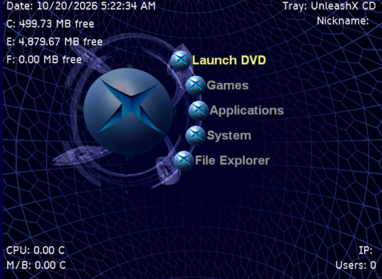
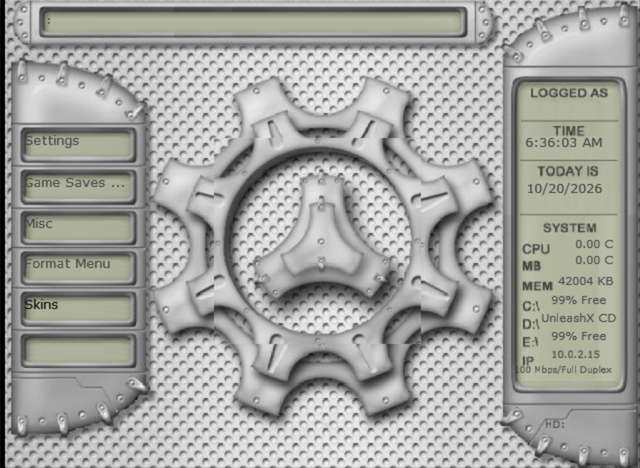

# UnleashX, decompiled

Readable, buildable C++ source for **UnleashX v0.39.0528A (Build 584,
2007)**, the classic replacement dashboard for the original Xbox. It was
recovered by hand from the release's `Default.xbe`, so the dashboard can be
read, fixed, modded and used as a base for new ones.

| | |
|---|---|
|  |  |
| The rebuilt XBE in xemu: the default skin | A zipped skin loaded from the disc |

> [!IMPORTANT]
> **This is not a 1:1 (byte-matching) decompilation.** The code is
> rewritten to *behave* like the original, not to compile back into the same
> bytes. A build is a new `Default.xbe` that works like UnleashX 0.39; it
> isn't the original file. Bugs and oddities of the original are **kept on
> purpose** and marked in the code, so it behaves as people remember it.

## At a glance

* **Target:** UnleashX 0.39.0528A Build 584, the last public release
  (`Default.xbe`, SHA-1 `a717b82d8506d6a21d1d5efb6fa1262c6b91f9bc`), built with XDK 5933.
* **What's source:** all of UnleashX's own code, one subsystem per folder
  in `src/`. Every function carries its address in the original. It's
  written from the binary.
* **Libraries:** these are linked as libraries, not decompiled:
  * Microsoft's XDK libraries;
  * the third-party code UnleashX used (libmad, unRAR, zip, FAT32,
    ftpparse), from public sources in `thirdparty/`.
* **Tested in [xemu](https://xemu.app):** nearly every feature, from the
  menus, skins and file manager to music, video, FTP, Live Update and USB
  sticks ([details below](#status)). Not yet tried on real hardware.

## Building

You need the **Xbox XDK 5933**. It's Microsoft's, so it isn't included.
Everything else is in this repository: UnleashX's media and skins, the
third-party sources and the disc tool.

```sh
git clone <this repo> && cd unleashx
make -f Makefile.xbox XDK=/path/to/xdk -j4 xiso   # Linux/macOS: also needs Wine, make, a C compiler, Python 3
```

The output is `build/xbox/default.xbe` and a bootable disc,
`build/xbox/UnleashX.iso`. On Windows, use the same command from MSYS2 or Git
Bash, or open `vs2003/UnleashX.sln` in Visual Studio .NET 2003.

* **WMV videos (optional):** the WMV decoder only shipped with XDK 4xxx.
  Add `WMVDEC=/path/to/xdk-4361`, or any XDK 4xxx; without it, `.xmv`
  still plays.
* **Host tests:** `make test` builds and runs them with any modern g++.
  They cover the XML, config, skin, FTP, HTTP, ISO 9660 and FAT32 code.

**[BUILDING.md](BUILDING.md)** covers each platform, running in xemu or on a
console, FTP into xemu, and changing the media.

<a id="status"></a>
## Status

<details>
<summary><b>Tested in xemu</b> (click to open)</summary>

* **Booting:** from the disc, and from the hard disk as the dashboard
  (`C:\xboxdash.xbe`).
* **Look:** the menus, the 3D background, the built-in skins and a zipped one,
  the screen saver.
* **Control Panel:** the pages, saved to `Config.xml`, plus the Xbox info
  pages.
* **Menu items:** password-protected items, the context menu, game
  launching and the recent list.
* **Item editor:** renaming a game (written into its XBE), and Download
  Online, both icon and preview.
* **File manager:**
  * the hard disk and data discs;
  * copy, zip and unzip, browsing and extracting RAR;
  * the picture, text and mesh viewers;
  * Copy Game Disc.
* **Music:** MP3, WMA and WAV, music folders, the music player screen.
* **Video:** WMV (with an XDK 4xxx decoder) and XMV.
* **Game saves manager:** the list, pictures, details, delete.
* **Network:**
  * the FTP server: upload, download, append, rename, delete, folders;
  * the FTP client, newsfeeds and SNTP time;
  * the skin downloader;
  * Live Update, end to end against a local server.
* **USB sticks (FAT32):** mounting partitions, browsing, copying both ways,
  music and pictures.

</details>

<details>
<summary><b>Not tested yet</b></summary>

* Real Xbox hardware. Everything above ran in xemu.
* Copying saves to a memory unit, and formatting one. xemu's memory units
  don't seem to support it.
* The hard disk lock. It's too risky on a disk image.
* Audio CDs, DVD movies, the IR remote, USB keyboards and mice, 5.1 sound
  and HD video modes.
* The Visual Studio .NET 2003 project in a real IDE. Only the make build is
  tested.

Reports from real consoles are very welcome.

</details>

<details>
<summary><b>Known quirks and limits</b> (all from the original; kept on purpose)</summary>

* **USB drives:** on P: to S:, copying, music and pictures work.
  * Text files, videos, Delete and New folder don't: they go through the
    kernel, which can't see these drives.
  * FTP transfers fail the same way.
  * See [FILE_MANAGER.md](docs/FILE_MANAGER.md#usb-drives) and
    [FTP.md](docs/FTP.md#quirks).
* **Plain ISO 9660 data discs:** they list fine, but text files on them open
  empty. See [TEXT_EDITOR.md](docs/TEXT_EDITOR.md).
* **Zips:**
  * Zips that UnleashX creates have no folder entries, so they look flat in
    its zip browser; extracting them still recreates the folders.
  * Password-protected zips can't be extracted.
  * See [FILE_MANAGER.md](docs/FILE_MANAGER.md#archives).
* **The `[Default]` skin:** right after startup its music player draws
  without colours. See [MUSIC.md](docs/MUSIC.md#the-music-player-screen).
* **Live Update:** a package must contain `UXUpdate.xbe`, as a Windows-made
  RAR. See [SETTINGS.md](docs/SETTINGS.md#live-update).

Most documentation pages list their subsystem's quirks, and the code
marks every one where it happens.

</details>

<details>
<summary><b>Different from the original</b></summary>

* **EEPROM keys:** decrypted values come from the kernel, which has already
  done the decryption. The results are the same: serial, MAC, region, hard
  disk key.
* **Third-party code:** some of it is a different version or a rewrite:
  * libmad, unRAR and zip_utils are public releases;
  * fat_io_lib has fixes for truncating files and for empty files;
  * the ISO 9660 reader and the HMAC-SHA1 are our own code.
  * See [thirdparty/README.md](thirdparty/README.md).
* **USB drives:** these have a 512 KB write cache, like the original's
  driver, and the free space is only recounted after a change.

</details>

## Documentation

How UnleashX works, written from the decompiled code:

| | |
|---|---|
| Look and feel | [Skins](docs/SKIN_FORMAT.md) · [Menus](docs/MENU.md) · [Menu actions](docs/MENU_ACTIONS.md) · [Language strings](docs/LANGUAGE_STRINGS.md) · [Keyboard](docs/KEYBOARD.md) |
| Settings | [Control Panel and `Config.xml`](docs/SETTINGS.md) · [Main loop](docs/MAINLOOP.md) |
| Files | [File manager](docs/FILE_MANAGER.md) · [File operations](docs/FILE_OPERATIONS.md) · [Drives](docs/DRIVES.md) · [Text editor](docs/TEXT_EDITOR.md) |
| Media | [Music](docs/MUSIC.md) · [Video](docs/VIDEO.md) · [Game saves](docs/GAME_SAVES.md) · [Launching games](docs/LAUNCHING.md) |
| Network | [FTP server and client](docs/FTP.md) · [Network, newsfeeds, Live Update](docs/NETWORK.md) |
| This project | [Building](BUILDING.md) · [How the decompilation is done](docs/DECOMPILING.md) · [Third-party code](thirdparty/README.md) |

<details>
<summary><b>Repository layout</b></summary>

| Path | What |
|---|---|
| `src/` | UnleashX's code by subsystem (`app/`, `ui/`, `skin/`, `filemgr/`, `audio/`, `net/`, ...); `src/xdk/` is UnleashX's modified copy of the XDK sample framework |
| `xbox/` | Xbox build support: adapters onto the third-party code, the ISO 9660 reader, the FAT32 driver interface |
| `thirdparty/` | libmad, unRAR, zip_utils, fat_io_lib, ftpparse, extract-xiso, with their licences |
| `assets/` | UnleashX's media, built-in skins, font and icons; `disc/` holds the files copied onto the disc |
| `vs2003/` | The Visual Studio .NET 2003 solution (generated by `tools/gen_vcproj.py`) |
| `tests/` | Host tests (`make test`) |
| `tools/` | The decompilation tools, and xemu helpers: FTP into xemu, a fake game save, a test proxy |
| `symbols/` | The naming database: every function and global of the original |
| `docs/` | The pages above |

</details>

## Credits and licences

* **UnleashX:** the work of the UnleashX team (2003-2007). The media, skins
  and language files in `assets/` come from the 0.39.0528A release.
* **Third-party libraries:** by their authors; see
  [thirdparty/README.md](thirdparty/README.md).
* **Microsoft:** this project isn't affiliated with Microsoft. The XDK is
  theirs; it's needed to build but isn't distributed here.
* **Licence:** the project's own code (`src/`, `xbox/`, `tests/`, `tools/`,
  the build files and the docs) is released under the
  [GNU GPL v3](LICENSE).
  * `assets/` is the UnleashX team's work.
  * `thirdparty/` keeps each library's own licence. libmad is GPL v2 or
    later, and fat_io_lib is GPL v3; a built `default.xbe` links both, so it
    falls under the GPL v3. unRAR's licence forbids using its code to make a
    RAR-compatible archiver.
